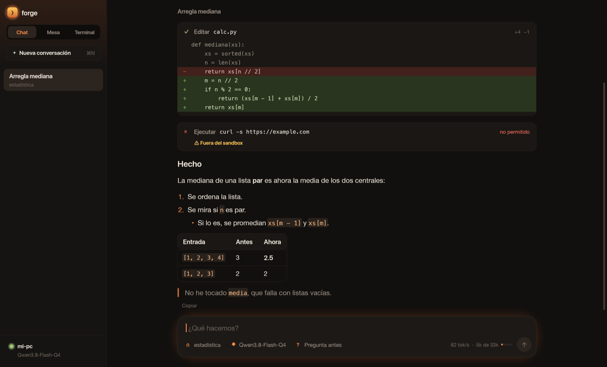

# Karbyx

[](LICENSE)
[](https://github.com/CurroRaya/karbyx/actions/workflows/comprobar.yml)

**Tu agente de programación para macOS, con los modelos que tienes en casa.**

Sirves un modelo en tu PC con llama.cpp o Strata y Karbyx, en el Mac, se conecta
a él por tu red: lee tu proyecto, lo edita y ejecuta comandos, pidiéndote
permiso (o sin pedirlo, si tú quieres). El modelo solo piensa: las herramientas
se ejecutan en el Mac y lo que lee viaja a tu PC, no a la nube, salvo que tú
añadas [algo que salga](#qué-sale-de-tu-mac). Es una app nativa, escrita en Rust
y dibujada por la GPU, y está en español.

> **Es una versión inicial (0.1).** Funciona y tiene tests, pero se ha probado en
> pocos equipos y puede cambiar. Úsala con git al día y lee [qué protege y qué
> no](#qué-protege-y-qué-no) antes de darle permisos.



*Captura hecha con un servidor de prueba: ni el modelo ni la velocidad son reales.*

| Vista | Qué es |
|---|---|
| **Chat** (⌘L) | El agente de Karbyx con tus modelos locales. Es con lo que se abre. |
| **Mesa** (⌘E) | Para dirigir varias tareas a la vez, con tu modelo local, Claude Code, Codex CLI o Gemini CLI, cada una en su propia copia del proyecto. |
| **Terminal** | Una terminal GPU completa, con paneles, bloques de comandos y el consumo de tus asistentes. |

Las conversaciones del chat se ven también en la mesa, y desde ella puedes lanzar
tareas a tu modelo local, cada una en su propia copia del proyecto.

Además:

- **[Memoria](#memoria-y-habilidades)**: recuerda lo que le pidas, sobre ti o
  sobre cada proyecto, y te enseña cada nota antes de guardarla.
- **[Habilidades](#memoria-y-habilidades)**: procedimientos en `SKILL.md`, los
  tuyos o los que encuentres con su buscador.
- **[Servidores MCP](#servidores-mcp)**: herramientas de otros programas y
  servicios, en tu Mac o remotos, con buscador en el registro oficial.
- **[Internet](#el-chat-l)**: lee páginas y, con un [buscador](#buscar-en-internet)
  de tu cuenta, busca; siempre te enseña antes qué sale de tu Mac.
- **[Ver](#el-chat-l)**: abre el HTML o el SVG que escribe el modelo (un juego,
  una página, un dibujo) en una ventana de Karbyx, sin red.
- **[Interrumpir](#el-chat-l)**: si no te gusta lo que hace, escríbele otra cosa
  y pulsa ↵; lo para y pasa a lo nuevo.

Karbyx es software libre: puedes usarlo, estudiarlo, modificarlo y compartirlo.
Las versiones modificadas que se distribuyan deben publicar su código con la
misma licencia, para que todas las mejoras sigan siendo de todos.

## Empezar en cinco minutos

**1. Instala Karbyx en el Mac** (necesitas [Rust y las herramientas de
Xcode](#requisitos)):

```bash
git clone https://github.com/CurroRaya/karbyx.git
cd karbyx
scripts/bundle.sh --install    # crea Karbyx.app y la copia a ~/Applications
```

**2. Abre Karbyx** (⌘Espacio, «Karbyx»), pulsa **Conectar con mi PC** y copia la
orden de tu servidor. Lleva una clave ya generada, que se rellena sola en el
formulario.

**3. En el PC**, pega la orden. Con llama.cpp, cambia `modelo.gguf` por la ruta
del tuyo:

```powershell
llama-server -m modelo.gguf --host 0.0.0.0 --port 8080 -c 32768 -ngl 99 --api-key CLAVE
```

```powershell
strata launch --access lan --port 8080 --api-key CLAVE
```

Si Windows pregunta por el cortafuegos, permite solo las redes privadas.

**4. Escribe la dirección del PC** en Karbyx (`192.168.1.50:8080`) y pulsa ↵. En
Windows la da `ipconfig`: la «Dirección IPv4» del adaptador que tiene puerta de
enlace. La primera vez, macOS pide permiso para la red local.

**5. Elige una carpeta** y pide algo.

## Requisitos

- **macOS** (probado en macOS 27 con Apple Silicon). Linux y Windows aún no están
  soportados: el PC del modelo puede ser cualquiera, pero Karbyx se ejecuta en un
  Mac.
- **Un servidor de modelos** con la API de OpenAI. Probado con llama.cpp y
  Gemma 4 26B; Strata y otros deberían funcionar, pero no los hemos probado. El
  modelo debe admitir **herramientas** para trabajar en una carpeta o usar
  internet, y se recomiendan **32k de contexto** o más.
- **Herramientas de línea de comandos de Xcode** (el enlazador que usa Rust):

  ```bash
  xcode-select --install
  ```

- **Rust 1.89 o superior** (se usa la edición 2024). Si no lo tienes, la forma
  recomendada es [rustup](https://rustup.rs):

  ```bash
  curl --proto '=https' --tlsv1.2 -sSf https://sh.rustup.rs | sh
  ```

  O con Homebrew:

  ```bash
  brew install rustup && rustup default stable
  ```

  Homebrew instala rustup sin enlazarlo al sistema, así que hay que añadirlo
  al `PATH` (y `~/.cargo/bin`, donde se instalan los programas de Rust):

  ```bash
  echo 'export PATH="/opt/homebrew/opt/rustup/bin:$HOME/.cargo/bin:$PATH"' >> ~/.zshrc && source ~/.zshrc
  ```

- **Opcional:** [Claude Code](https://claude.com/claude-code), Codex CLI o
  Gemini CLI para la mesa, sus sesiones y el panel de consumo. Los servidores MCP
  que se lanzan con `npx` necesitan [Node](https://nodejs.org), y los de `uvx`,
  [uv](https://docs.astral.sh/uv/).

## Instalación

### Como app de macOS (recomendado)

```bash
scripts/bundle.sh --install    # crea Karbyx.app y la copia a ~/Applications
```

Crea `target/release/Karbyx.app`, con su icono y firmada para este Mac, y con
`--install` la copia a `~/Applications`. Desde ahí la abres con Spotlight
(⌘Espacio, «Karbyx») o la anclas al Dock. Sin `--install` solo la crea.

Abierta desde el Dock, sus terminales empiezan en tu carpeta personal y toman
el idioma de macOS (`LANG`), como Terminal.

### Desde la terminal

```bash
cargo install --path crates/karbyx-app      # la app          → ~/.cargo/bin/karbyx-app
cargo install --path crates/karbyx-usage    # CLI de consumo  → ~/.cargo/bin/karbyx-usage
```

La primera compilación tarda unos minutos; las siguientes, segundos.

## Ejecutar

Una vez instalado, desde cualquier terminal:

```bash
karbyx-app                 # abre Karbyx
karbyx-usage               # resumen de consumo de tus asistentes
karbyx-usage watch         # consumo en directo
karbyx-usage -p claude daily
```

Sin instalar, desde la carpeta del proyecto:

```bash
cargo run --release -p karbyx-app
cargo run --release -p karbyx-usage -- watch
```

Si lo lanzas desde una terminal y quieres poder cerrarla sin que se cierre
Karbyx, lánzalo desvinculado (o usa la [app](#como-app-de-macos-recomendado)):

```bash
karbyx-app &!
```

## Actualizar

```bash
cd karbyx
git pull
scripts/bundle.sh --install                # si usas la app
cargo install --path crates/karbyx-app      # si la instalaste con cargo
cargo install --path crates/karbyx-usage
```

Cierra Karbyx antes y vuelve a abrirla después.

## Desinstalar

```bash
cargo uninstall karbyx-app karbyx-usage
rm -rf ~/Applications/Karbyx.app                  # si instalaste la app
rm -rf ~/Library/Caches/karbyx                    # caché (opcional)
rm -rf ~/.config/karbyx                           # configuración, tus habilidades y servidores MCP (opcional)
rm -rf ~/Library/Application\ Support/karbyx      # conversaciones, memoria, sesiones y claves (opcional)
```

Karbyx no modifica tu `.zshrc` ni tus ajustes (solo edita lo que le permites en
la carpeta que elijas). La integración con zsh
vive en `~/Library/Caches/karbyx` y desaparece con ella.

## Solución de problemas

| Problema | Solución |
|---|---|
| «No llego a…» al conectar | El PC está en otra red, o Karbyx no tiene permiso en *Ajustes del Sistema › Privacidad y seguridad › Red local*. |
| «… no responde» al conectar | El PC está apagado o el cortafuegos de Windows corta el puerto. Comprueba también la IP: el router puede cambiarla. |
| «… no hay nada en el puerto 8080» | El servidor no está arrancado, usa otro puerto o solo escucha en el propio PC: falta `--host 0.0.0.0` (llama.cpp) o `--access lan` (Strata). |
| «El servidor pide una clave» | La clave de Karbyx no es la de `--api-key`. Menú de modelos › *Editar*. |
| El modelo contesta, pero no usa las herramientas | Para leer o editar archivos, elige una carpeta. Si ya la tienes, o tampoco busca en internet, ese modelo o su plantilla no las admiten. |
| «Falta elegir buscador» al buscar | Para buscar hace falta un buscador con tu clave: pulsa **Elegir buscador** o ve a **Buscador**, abajo a la izquierda. |
| «El buscador no acepta la clave» | La clave está mal copiada, se ha borrado o se ha acabado el plan: créala de nuevo en la web del buscador y pégala en **Buscador**. |
| Una página no se puede leer | Solo se leen páginas de texto (HTML, JSON, texto…) de hasta 5 MB; las que se dibujan con JavaScript pueden llegar casi vacías. |
| *Ver* abre la ventana, pero el juego o la página no funcionan | La vista previa no tiene red: lo que cargue de fuera (librerías de una CDN, imágenes, fuentes) no llega. Pídele al modelo que lo meta todo en el archivo. |
| «No se pudo bloquear la red: no se abre» | La vista previa no se abre si no puede aislarse. Reabre Karbyx; si sigue, cuéntalo en un *issue* con tu versión de macOS. |
| ↵ no para al modelo | Si te está pidiendo permiso, ↵ le manda lo escrito como respuesta; para pararlo, **esc**. |
| Olvida detalles en tareas largas | El contexto se llena y se resume: arranca el servidor con más (`-c`) o empieza otra conversación (⌘N). |
| Un servidor MCP no arranca | Falta el programa que lo lanza (`npx`, `uvx`, `docker`...). El panel *Servidores MCP* enseña su error. |
| Un MCP remoto no deja iniciar sesión | No admite otros programas: crea una clave en su web y pégala en *Clave*. El transporte antiguo (SSE) no está soportado. |
| Con MCP, el contexto se llena enseguida | Sus herramientas ocupan sitio: apaga las que no uses o actívalo solo en el proyecto que lo necesita. |
| No encuentra una habilidad o un servidor | Los catálogos no los tienen todos: pega la dirección de GitHub, la carpeta o su JSON. |
| «Un archivo de Karbyx estaba dañado» al abrir | Se ha apartado con `.roto` al final, en `~/Library/Application Support/karbyx`, y Karbyx sigue con uno nuevo. Si era `chat.json`, vuelve a conectar tu PC; si era `chat.sesiones`, inicia sesión otra vez en tus MCP. |
| `zsh: command not found: cargo` | Rust no está en el `PATH`; ver [Requisitos](#requisitos) y abre una terminal nueva. |
| `command not found: karbyx-app` tras instalar | Falta `~/.cargo/bin` en el `PATH` (misma línea de arriba). |
| `linker 'cc' not found` al compilar | Instala las herramientas de Xcode: `xcode-select --install`. |
| No aparecen los bloques de comandos | Solo funcionan con zsh y la integración activa (`shell_integration = true`). Abre una pestaña nueva tras cambiarlo. |
| El panel de consumo no sale | Aparece solo en pestañas con una sesión de IA; fuérzalo con ⌘⌥B. |
| Va lento o quieres medirlo | `KARBYX_PROFILE=1 karbyx-app` muestra el tiempo de cada frame. |

## Estructura del proyecto

| Crate | Qué hace |
|---|---|
| `karbyx-agent` | El agente, sin interfaz: cliente del servidor de modelos (streaming y cancelación), bucle de herramientas con permisos, resumen del contexto, memoria y habilidades, lectura de páginas y búsqueda en internet, cliente MCP (en el Mac y remoto, con OAuth), los buscadores del registro MCP y de skills.sh, y el sandbox de macOS con la ejecución de comandos |
| `karbyx-app` | La app: render por GPU (wgpu + glyphon), chat con sus conversaciones guardadas, vista previa sin red (WebKit), paneles de memoria, habilidades y MCP, mesa, terminales con pestañas y paneles, panel de consumo, `karbyx.toml` con temas y atajos |
| `karbyx-term` | Sesión de terminal independiente de la UI: PTY con bucle de E/S propio + emulador VT (`alacritty_terminal`), bloques OSC 133 e integración con zsh, selección, búsqueda, protocolos de ratón y snapshot del grid |
| `karbyx-ai` | Lee el historial de Claude Code (`~/.claude`), Codex CLI (`~/.codex`) y Gemini CLI (`~/.gemini/tmp`), lo normaliza, deduplica y calcula ventanas de 5 h, semana, proyecciones y límites oficiales cuando el proveedor los publica (Codex) |
| `karbyx-usage` | CLI de consumo: `summary`, `daily`, `blocks`, `models`, `projects`, `watch`, `line`, `--json`, `-p claude\|codex\|gemini` |

## Uso

### El chat (⌘L)

- **Carpeta**: elígela abajo a la izquierda y el modelo podrá leer, buscar,
  editar y ejecutar en ella. Sin carpeta es un chat normal, que solo puede usar
  internet, la memoria y las habilidades.
  Una conversación empezada se queda en su carpeta. Si el proyecto tiene
  `AGENTS.md` (o `CLAUDE.md`), el modelo lo lee al empezar.
- **Modelo**: el menú junta los de todos tus servidores. Si el tuyo se apaga,
  Karbyx lo reintenta solo. Desde ahí se abre también **Claude Code**, en una
  terminal de Karbyx y en la misma carpeta, con tu suscripción y sus permisos.
- **Permisos**: leer dentro de la carpeta es libre; editar y ejecutar se
  preguntan enseñando el diff o el comando. **⌘↵** permite, **esc** para, y si
  escribes otra cosa el modelo la recibe como respuesta.
- **Automático** (⇧⇥, o *Siempre en este chat*): edita en la carpeta y ejecuta
  en el sandbox sin preguntar; lo que se sale, lo pregunta. Trabaja sobre tus
  archivos, no sobre una copia: úsalo con git al día.
- **Total**: **no pregunta nada**. Ejecuta fuera del sandbox, sale de la carpeta,
  lee archivos con claves, usa internet y tus servidores MCP y guarda en la memoria. Se elige
  en el menú de permisos, confirmándolo, y vale solo para esa conversación hasta
  que cierres Karbyx. Un modelo puede equivocarse, o una página o un archivo pueden
  engañarlo: puede borrar cosas tuyas o enviarlas fuera. Lo que hace queda a la
  vista en el chat, pero ya hecho. Arrancar un servidor MCP nuevo se sigue
  aprobando aparte.
- **Mientras trabaja**, si no te gusta lo que hace, escribe otra cosa y pulsa
  **↵**: lo para y le llega tu mensaje en cuanto se detiene, con lo que ya había
  hecho a la vista. Con **⌘↵** el mensaje espera a que acabe. **esc** lo para sin
  más. Puedes tener varias conversaciones a la vez, y Karbyx
  avisa si una termina o pide permiso y no la estás viendo.
- **Conversaciones**: se guardan solas a cada paso y siguen ahí al reabrir
  Karbyx, ordenadas por fecha. Si lo cierras con una a medias, se para y puedes
  continuarla. Al reabrir, todas vuelven a preguntar antes de cambiar nada. La ×
  (dos clics) la borra.
- **Copiar**: arrastra por la conversación; si sales por arriba o por abajo se
  desplaza sola, y también puedes usar la rueda mientras arrastras. **⌘A** la
  selecciona entera (con algo escrito, antes selecciona lo escrito). Para coger
  desde un punto hasta otro lejano, haz clic en el primero, desplázate y pulsa
  **⇧ clic** en el segundo; **⌘⇧↓** y **⌘⇧↑** van hasta el final o el principio.
  Se copia lo que está desplegado.
  Debajo de cada mensaje tuyo y de cada respuesta hay **Copiar**, que coge
  ese mensaje entero, y la fecha y hora en que se envió o se terminó de
  escribir; en las respuestas, también lo que tardó desde tu mensaje.
- **Ver**: los bloques de HTML o SVG llevan **Ver** junto a *Copiar* (los dos se
  quedan a la vista al desplazarte por un bloque largo). Abre lo que
  ha escrito el modelo (un juego, una página, un dibujo) en una ventana con el
  motor de Safari, **sin red**: no puede cargar nada de internet ni irse a otra
  página. Lo que necesite de fuera, como librerías de una CDN, no funcionará;
  pídele que lo meta todo en el archivo. No guarda nada entre una vista y otra.
- **Internet**: pídele que busque algo o pásale una dirección y la leerá como
  texto, con sus enlaces. Cada vez te enseña la dirección o lo que va a buscar y
  pregunta, también en Automático, porque eso sale de tu Mac: un modelo engañado
  podría meter en una dirección algo de tus archivos. *Siempre en* ese sitio y
  *Siempre al buscar* valen hasta que acabe la conversación. Leer páginas
  funciona sin más; para **buscar** necesitas elegir un
  [buscador](#buscar-en-internet) con tu propia clave. Una página larga se lee
  por partes, para no llenar el contexto.
  Lo que sabe el modelo acaba cuando lo entrenaron, así que Karbyx le dice la
  fecha de hoy y que busque lo que pueda haber cambiado (versiones, noticias,
  precios). Si aun así contesta con datos viejos, pídele que lo busque.
- **Contexto**: abajo a la derecha se ve cuánto llevas usado y la velocidad.
  Al llegar a tres cuartos, el modelo **resume** lo antiguo y sigue, conservando
  tal cual lo último y tu petición; el resumen se puede ver en la conversación.
  Se puede pedir antes pulsando ahí (*Resumir ahora*). Si el modelo no consigue
  resumir, se olvidan los resultados antiguos de sus herramientas.

| Herramienta | Qué hace | Permiso |
|---|---|---|
| `read`, `list`, `search`, `find` | Leer, listar, buscar en el contenido y por nombre | Libre dentro de la carpeta |
| `edit`, `write` | Cambiar una parte de un archivo, o crearlo | Se pregunta, con el diff |
| `bash` | Ejecutar un comando en la carpeta, dentro del sandbox | Se pregunta |
| `skill` | Leer una habilidad | Libre |
| `fetch` | Leer una página de internet o de tu red | Se pregunta siempre (\*), salvo los sitios que digas |
| `web_search` | Buscar en internet | Se pregunta siempre (\*), salvo si dices *Siempre al buscar* |
| `servidor__herramienta` | Herramientas de tus servidores MCP | Se pregunta siempre (\*), salvo las que digas |
| `remember`, `forget`, `save_skill` | Cambiar la memoria y las habilidades | Se pregunta siempre (\*) |

(\*) Menos en Total, que no pregunta nada.

**Se pregunta siempre**, también en Automático (pero no en Total): ejecutar fuera del sandbox,
salir de la carpeta, leer archivos que suelen tener claves (`.env`, `*.pem`...)
y escribir en `.karbyx`, `.claude`, `.mcp.json`, `AGENTS.md` y similares, que otras
herramientas leen. En `.git` no se puede escribir con `edit` ni `write`.

#### Buscar en internet

Los buscadores no dejan que un programa busque sin una cuenta: a Karbyx le
piden demostrar que es una persona. Claude, ChatGPT y el resto también pagan
un buscador; aquí usas el tuyo, con tu clave. Hasta que lo elijas, el modelo
puede leer las páginas que conozca, pero no buscar, y si lo intenta verás
**Elegir buscador** en el chat.

Abajo a la izquierda, **Buscador** (dice *sin elegir* mientras no tengas
uno):

| Buscador | Qué necesitas |
|---|---|
| **Tavily** (recomendado) | Una cuenta en [tavily.com](https://tavily.com). Tiene un plan gratuito, sin tarjeta. Copia la clave (`tvly-…`). |
| **Brave** | Una cuenta en la [API de Brave Search](https://api-dashboard.search.brave.com). Pide tarjeta y trae crédito cada mes. |
| **SearXNG** | Un servidor SearXNG, tuyo o de confianza, con el formato JSON activado. Escribe su dirección. |

**Probar y guardar** hace una búsqueda de prueba con lo que has puesto: si la
clave no vale, te lo dice y no se guarda. La clave queda en
`~/Library/Application Support/karbyx/chat.json`, solo para ti. Cada búsqueda
te enseña antes lo que se envía y a qué servicio. **Quitar** lo olvida.

#### Memoria y habilidades

Abajo a la izquierda, **Memoria y habilidades** enseña lo que tu modelo tiene en
cuenta en cada conversación.

- **Memoria**: notas cortas, sobre ti o sobre cada proyecto. Díselo («recuerda
  que prefiero respuestas cortas», «recuerda que aquí los tests se lanzan con
  `make test`») y verás la nota exacta antes de guardarla. Se olvidan con la ×,
  pidiéndoselo, o editando el archivo. Lo que parece una clave no se guarda.
- **Habilidades**: procedimientos que se repiten. Escribe **/** para elegir una
  (`/revisar solo el login`), o el modelo la usa cuando viene al caso. Trae tres
  de serie (`/revisar`, `/tests`, `/documentar`); pide «guarda esto como
  habilidad» para crear otra. Son carpetas con un `SKILL.md`, el formato de
  Claude Code:

  ```markdown
  ---
  description: Cuándo usarla, en una frase
  ---

  Los pasos, en Markdown.
  ```

  **Buscar e instalar…** las busca por nombre en [skills.sh](https://skills.sh) (lo
  que escribes se envía a su web al pulsar ↵), o las trae de una dirección de GitHub
  (`dueño/nombre`) o de una carpeta. Siempre se bajan del repositorio y te enseña el
  `SKILL.md` entero y qué archivos trae antes de copiarla. Nada se ejecuta al
  instalar, y los programas pierden el permiso de ejecución. Nadie comprueba que
  sean de fiar, por muchas instalaciones que tengan.

  Las tuyas van en `~/.config/karbyx/skills/<nombre>/`; las de un proyecto, en
  `.karbyx/skills/` o `.claude/skills/`. Si se llaman igual, manda la tuya. Las de
  un proyecto ajeno son instrucciones de otro: léelas antes, sobre todo si vas a
  usar Automático o Total.

El modelo **no guarda nada sin tu permiso**, tampoco en Automático (en Total, sí), y las
tareas lanzadas desde la mesa no pueden ni pedirlo. La memoria está sin cifrar en
`~/Library/Application Support/karbyx/chat.memoria`, solo para ti. Un cambio de
memoria se nota en las conversaciones nuevas o reabiertas (borrar una nota, en el
siguiente mensaje).

#### Servidores MCP

Tu modelo puede usar herramientas de otros programas con
[MCP](https://modelcontextprotocol.io). En **Servidores MCP**:

- **Buscar…** consulta el [registro oficial](https://registry.modelcontextprotocol.io)
  y pide solo lo que cada servidor necesita (claves, opciones), con la explicación de
  su autor. Lo que escribes se envía a esa web al pulsar ↵. El registro comprueba
  **quién** publica (su dominio o su cuenta de GitHub), no que sea de fiar: fíjate en
  el autor.
- **Añadir a mano…** acepta el JSON de `mcpServers` que dan en su web, la orden con
  la que se lanza (`npx -y paquete`) o su dirección (`https://…`).

Cómo se tratan:

- **En tu Mac**: es un programa que se ejecuta fuera del sandbox y con tus
  permisos. Karbyx enseña la orden entera antes de arrancarlo.
- **Remotos** (*Streamable HTTP*; el transporte antiguo, SSE, no): **lo que el
  modelo les mande sale de tu Mac**. Si piden cuenta, **Iniciar sesión** abre tu
  navegador. Si el servicio no deja iniciar sesión desde otros programas, créale
  una clave en su web y pégala en el campo *Clave*. Fuera de tu red, solo
  `https://`.
- **Lo que apruebas es lo que se usa**: si la orden, la dirección o las cabeceras
  cambian en el archivo, vuelve a pedirte permiso. El `.mcp.json` de un proyecto no
  se carga solo; *Traer del proyecto* lo enseña para que lo revises.
- **Cada llamada se pregunta**, también en Automático (no en Total), enseñando sus datos.
  *Siempre esta herramienta* deja de preguntar por ella.
- **Cada herramienta ocupa contexto** (el panel dice cuánto). Actívalos solo en
  los proyectos que los usan, y apaga las herramientas que sobren.

Se guardan en `~/.config/karbyx/mcp.json` y las sesiones iniciadas, en
`~/Library/Application Support/karbyx/chat.sesiones`: solo los puedes leer tú, y los
comandos del sandbox no los ven. *Cerrar sesión* la olvida en este Mac; para
retirar el permiso del todo, hazlo en la web del servicio.

#### Qué protege y qué no

- Los comandos se ejecutan en el **sandbox de macOS** (salvo los que permitas
  fuera, o en Total, los que el modelo decida): sin red, sin lanzar
  otras apps, sin leer las claves habituales (`~/.ssh`, `~/.aws`, llavero,
  `~/.claude`...) y escribiendo solo en la carpeta, una caché de compilación y
  una carpeta temporal. Si no se puede aislar, no se ejecutan. El resto de tus
  archivos sí se puede leer, y un comando puede leer el `.env` del proyecto.
- La conexión con el PC es **HTTP sin cifrar**: la conversación y la clave
  viajan en claro. Úsala en tu red o por una VPN, y nunca abras el puerto a
  internet. Pon siempre una clave: sin ella, cualquiera de tu red puede usar el
  modelo.
- Los servidores, sus claves y la del buscador se guardan en
  `~/Library/Application Support/karbyx/chat.json`, que solo tú puedes leer.
- Las **conversaciones** se guardan sin cifrar en
  `~/Library/Application Support/karbyx/chat.d`, también solo para ti, con lo que
  el modelo haya leído de tus archivos. Borrarlas en Karbyx las borra del disco.
- Una **página de internet** puede traer texto escrito para engañar al modelo.
  Se le dice que es solo información, y lo que haga después se te sigue
  preguntando como siempre; en Total, no. Si le pides leer una web, mejor no
  uses Total en esa conversación.
- La **vista previa** (*Ver*) ejecuta el JavaScript que haya escrito el modelo,
  pero sin red ni acceso a tus archivos. WebRTC también se le quita, aunque eso
  se hace desde la propia página y no es tan sólido como el bloqueo de la red.

#### Qué sale de tu Mac

Por sí solo, Karbyx habla únicamente con tu servidor de modelos. Lo demás solo
ocurre si tú lo haces, lo añades o lo permites:

| Cuándo | Adónde va | Qué |
|---|---|---|
| Si el modelo lee una página | Esa dirección | La dirección entera (se te enseña antes) |
| Si el modelo busca en internet | El buscador que elijas (Tavily, Brave o tu SearXNG), con tu clave | Lo que busca (se te enseña antes) |
| Al buscar un servidor MCP | `registry.modelcontextprotocol.io` | Lo que escribes |
| Al buscar una habilidad | `skills.sh` | Lo que escribes |
| Al traer una habilidad | GitHub | Qué repositorio |
| Con un servidor MCP remoto activo | Ese servicio, y donde inicies sesión | Lo que el modelo le mande: se te enseña antes, salvo en las herramientas que marques con *Siempre* o en Total |
| Con un servidor MCP activo en tu Mac | Lo que decida ese programa | Se ejecuta con tus permisos y con red |
| En modo Total | Adonde decida el modelo | Puede ejecutar cualquier cosa con red, sin enseñártela antes |
| Si tus tests usan red (`[verify] network`) | Lo que hagan esos tests | Podrían enviar lo que pueden leer |
| Si permites un comando *Fuera del sandbox* | Lo que haga ese comando | Se te enseña antes |
| Si usas Claude Code, Codex CLI o Gemini CLI | Su proveedor | Lo que haga ese asistente, con su cuenta |

### La mesa (⌘E)

Para dirigir varias tareas a la vez, con tu modelo local o con Claude Code, Codex
CLI y Gemini CLI. Cada agente tiene
temperatura: los que trabajan laten como brasas, el que te espera está al rojo
y lo terminado se enfría a acero.

- **«¿Qué hay que hacer?»**: escribe la tarea y pulsa ↵. Karbyx lanza un agente
  en un **worktree propio** del proyecto elegido, con la tarea ya escrita. ⇧⇥
  cambia quién la hace (tu modelo local, si tienes un servidor, o un asistente
  instalado) y ⇥, el proyecto (los de tus terminales abiertas). Fuera de un
  repositorio git, el agente trabaja en la carpeta, sin worktree.
- **Tu modelo local** trabaja en su copia en modo Automático (edita en ella y
  ejecuta en el sandbox; lo demás se pregunta) y como una conversación más, que
  puedes abrir y seguir. Al acabar se verifica, se revisa y se fusiona igual que
  las demás. Sin repositorio git trabaja en la carpeta y pregunta antes. Una
  conversación reabierta tras cerrar Karbyx vuelve a preguntar.
- **Columnas**: *Trabajando*, *Te necesita*, *Para revisar* y *Hecho hoy*.
  Cada tarjeta muestra la tarea, el proyecto y la rama, lo que hace ahora,
  una **miniatura en vivo de su terminal** (un minimapa con los colores
  reales: se ve si está escribiendo código, pasando tests o con un diff en
  pantalla), su última línea, sus `+/−` y sus tokens.
- **Responder sin entrar**: cuando un agente te pide permiso («¿Aplico este
  cambio en login.rs?»), su tarjeta muestra la pregunta y un botón por opción
  (*Sí*, *Sí, siempre*, *No*). Un clic, o la tecla 1-3 con la tarjeta
  seleccionada, responde en su terminal. Karbyx vuelve a leer la pantalla antes
  de enviar nada: si la pregunta ya no está, no responde.
- **Verificación automática**: cuando un agente termina en su worktree, Karbyx
  puede ejecutar los tests en segundo plano, sin gastar tokens, y la tarjeta
  llega a *Para revisar* con un sello: **✓ 36 tests en verde** o **✕ 2 tests
  fallan** (o *No compila*). Viene desactivada: la primera vez Karbyx pregunta
  **¿Verifico?** y eliges *Una vez* o *Siempre* (en ese proyecto). Con un
  fallo, **Que lo arregle** le pasa al agente la salida completa; ↻ repite y
  **Verificar** la lanza a mano (p. ej. con Codex o Gemini, que no avisan de
  cuándo terminan). El comando se detecta solo (`cargo test`,
  `npm`/`pnpm`/`yarn`/`bun test`, `go test`, `pytest`, `make test`) o se
  configura en `[verify]`.
  - **Aislada**: los tests son código que ha podido escribir el agente y que
    aún no has revisado, así que se ejecutan siempre en el sandbox de macOS:
    sin red, sin lanzar otras apps, sin leer las claves habituales (`~/.ssh`,
    `~/.aws`, llavero, `~/.claude`...) y escribiendo solo en el worktree, la
    caché de compilación y una carpeta temporal. Si no se puede aislar, no se
    ejecuta. El resto de tus archivos sí se puede leer.
  - Si el agente ha cambiado algo que decide qué se ejecuta (`Makefile`,
    `build.rs`, `Cargo.toml`, `package.json`...), Karbyx lo dice y espera a que
    pulses *Verificar*, aunque el proyecto esté activado.
  - Si tus tests necesitan red (o `localhost`): `[verify] network = ["proyecto"]`.
    Con red, un test podría enviar fuera lo que puede leer.
  - Los proyectos activados están en `~/Library/Caches/karbyx/verify-projects.txt`,
    uno por línea: borra la línea para desactivarlo.
- **Conversaciones del chat**: las abiertas y las de hoy salen en las mismas
  columnas. Se puede permitir o negar un cambio desde la tarjeta; los comandos y
  lo que se pregunta siempre se deciden viéndolos en el chat.
- Clic en una tarjeta (o ↑↓ y ↵) abre su terminal; **Revisar** abre el diff
  (⌘R) para fusionar o descartar. Abajo, tus terminales normales.
- **⌘E** alterna entre la mesa y las terminales; ⌘T, ⌘⇧C... también te llevan
  a las terminales.

### Atajos

| Atajo | Acción |
|---|---|
| ⌘L · ⌘N | El chat / conversación nueva |
| ⌘E | La mesa de agentes / volver a las terminales |
| ↵ / ⇧↵ | Enviar / línea nueva (en el chat) |
| ⌘↵ / esc | Permitir lo que pide el modelo / no permitirlo y parar |
| ↵ / ⌘↵ mientras trabaja | Pararlo y decirle lo escrito / decírselo al acabar (si está pidiendo permiso, ⌘↵ permite) |
| ⇧⇥ | Preguntar antes / Automático (en el chat; *Total*, en su menú); quién hace la tarea (en la mesa) |
| ⌘T / ⌘⇧C | Nueva pestaña de terminal / del asistente seleccionado |
| ⌘D / ⌘⇧D | Dividir el panel a la derecha / abajo |
| ⌘⌥←→↑↓ | Moverse entre paneles |
| ⌘W | Cerrar el panel activo (o la pestaña si es el último) |
| ⌘1…⌘9, ⌃Tab, ⌘⇧↑/↓ | Cambiar de pestaña |
| ⌘F, ⌘G / ⌘⇧G | Buscar en el historial, siguiente / anterior (↵ y ⇧↵ dentro de la barra) |
| ⌘C / ⌘V | Copiar la selección / pegar (con bracketed paste) |
| ⌘A | Seleccionar toda la conversación o toda la terminal, con su historial |
| ⇧ clic | Extender la selección hasta ahí |
| ⌘⇧↑ / ⌘⇧↓ (tras un clic en la conversación) | Seleccionar hasta el principio / el final |
| ⌘B / ⌘⌥B | Mostrar u ocultar la barra de sesiones / el panel de consumo (este aparece solo en pestañas con una sesión de IA; ⌘⌥B lo fuerza en la pestaña actual) |
| ⌘+ / ⌘- / ⌘0 | Tamaño de fuente |
| ⌘← / ⌘→, ⌥← / ⌥→, ⌘⌫ | Inicio / fin de línea, palabra anterior / siguiente, borrar línea |
| ⌘↑ / ⌘↓ | Seleccionar el comando (bloque) anterior / siguiente; Esc quita la selección |
| ⌘C (con un bloque seleccionado) | Copiar el comando y su salida |
| ⌘I | Preguntar a la IA por el bloque seleccionado o el último que falló |
| ⌘J | Bandeja de agentes: los que te esperan primero; ↑↓ y ↵ para ir a uno |
| ⌘U | Panel de mando: consumo de todos los asistentes y agentes abiertos |
| ⌘⇧A | Agente nuevo en su propio worktree de git |
| ⌘R | Revisar cambios: diff del agente (fusionar ↵, descartar ⌫) o de la terminal |
| ⌘K | Limpiar pantalla |
| ⌘Q | Salir |

**Ratón:** arrastrar selecciona, doble clic selecciona una palabra, triple
clic la línea y ⌥+arrastrar un bloque rectangular. Al arrastrar más allá del
borde, el historial se desplaza solo. Los divisores entre
paneles se arrastran. Si la aplicación pide el ratón (vim, htop, tmux) los
clics le llegan a ella; con ⇧ se fuerza la selección normal.

### Agentes externos: Karbyx sabe qué hacen

Con Claude Code, Codex CLI y Gemini CLI, en la mesa o en una terminal:

- **Estado en la barra lateral:** cada sesión de un agente muestra si está
  **trabajando** (◐), **te espera** (● naranja) o ha **terminado** (✓), con su
  tarea como título, lo que hace ahora («Editando ui.rs», «Ejecutando: cargo
  test») y desde cuándo.
- **Agrupadas por proyecto** (la raíz del repositorio git de cada sesión).
- **Bandeja de atención (⌘J):** todos los agentes de todas las pestañas, los
  que te esperan primero. El aviso «● N te esperan» de la cabecera la abre.
- **Avisos de macOS** cuando un agente te espera o termina y no lo estás viendo.
- **Panel de mando (⌘U):** una tarjeta por asistente (hoy, ventana de 5 h,
  semana y las últimas 24 h por horas), el histórico de 14 días apilado por
  asistente, los agentes abiertos con los tokens que lleva cada sesión (Claude)
  y los proyectos que más consumen esta semana.

Con **Claude Code** el estado es exacto: Karbyx lo lanza con
`--settings` y unos *hooks* que le cuentan cada paso (también si escribes
`claude` a mano en una terminal de Karbyx). Tus ajustes de Claude no se tocan.
Con otros agentes (Codex, Gemini...) se deduce de su actividad.

### Los agentes externos ven tus terminales (MCP)

Karbyx es también un servidor [MCP](https://modelcontextprotocol.io): un
agente que corre dentro de Karbyx puede ver las otras terminales sin que
copies nada. Pídele, por ejemplo, «mira el error de la otra terminal» o «¿por
qué ha fallado lo último que ejecuté?». Herramientas, todas de **solo
lectura** (un agente nunca escribe en tus terminales):

| Herramienta | Qué hace |
|---|---|
| `list_terminals` | Terminales abiertas: pestaña, proyecto, carpeta y estado de cada agente |
| `read_terminal` | Últimas líneas de una terminal, tal como las ves |
| `list_commands` | Últimos comandos con su código de salida y duración |
| `read_command` | Un comando con su salida completa (por defecto el último; `failed` = el último que falló) |

Sin indicar terminal, usan la que tienes delante o la última que usaste.
**Claude Code** lo trae configurado: Karbyx lo lanza con `--mcp-config` y
permite estas herramientas sin preguntar (compruébalo con `/mcp`). Para otros
clientes MCP, añade un servidor stdio con el comando `karbyx-app mcp`; solo
funciona dentro de una terminal de Karbyx.

### Un worktree por agente y revisión de cambios

Para que varios agentes trabajen en el mismo proyecto sin pisarse, **⌘⇧A**
abre el agente en su **propio worktree de git**: una copia del repositorio en
`<proyecto>.worktrees/agente-N`, junto al proyecto, con su rama
`karbyx/agente-N` creada desde el último commit (lo que tengas sin commit no
se lleva). La barra lateral lo marca con `⎇ agente-N`.

**⌘R** abre el panel **Revisar cambios** del panel activo: la lista de
archivos tocados con sus `+/−` y el diff de cada uno, que se actualiza solo
mientras el agente trabaja. En un agente con worktree:

- **↵ Fusionar** guarda en un commit lo pendiente (con la tarea del agente
  como mensaje) y lo fusiona en la rama actual del proyecto. Si hay
  conflictos no se toca nada y te lo dice.
- **⌫ Descartar** (dos veces, para confirmar) cierra el agente y borra su
  worktree y su rama.

En cualquier otra terminal dentro de un repositorio, ⌘R muestra lo que hay
sin commit. Si cierras el agente sin fusionar, el worktree se queda: abre una
terminal en esa carpeta y ⌘R lo vuelve a encontrar.

### Bloques de comandos (estilo Warp)

Con zsh, Karbyx activa sola una integración con la shell (no toca tu
`.zshrc`): cada comando y su salida forman un **bloque**.

- Un separador fino entre comandos; los que fallan llevan una barra y un tinte
  rojos y la etiqueta `✗ código`; los que tardan muestran su duración (`✓ 2,4 s`).
- Clic en el margen izquierdo o ⌘↑/⌘↓ para seleccionar un bloque; ⌘C copia
  el comando con su salida.
- En un bloque fallido aparece **◆ Preguntar a Claude** (o al asistente
  activo): abre al lado una sesión con el comando, el error y la salida ya
  escritos.
- Si un comando largo termina mientras Karbyx no está a la vista, llega un
  aviso de macOS.

Las marcas son el estándar OSC 133, así que también funcionan con otras
shells que las emitan (bash con su propia integración, fish, starship...).

### Configuración (`~/.config/karbyx/karbyx.toml`)

Se aplica al guardar, sin reiniciar:

```toml
[font]
family = "Menlo"
size = 14
line_height = 1.3

[window]
padding = 10
start = "chat"             # o "mesa" o "terminal": qué se ve al abrir

[terminal]
scrollback = 10000
option_as_alt = false      # true: ⌥ envía Meta (ESC+tecla) en vez de @, #, ñ...
shell_integration = true   # bloques de comandos (zsh)
notify_after_secs = 10     # aviso al terminar comandos largos (0 = nunca)

[theme]
name = "forja"             # forja (carbón y brasa) | one-dark | dracula | solarized-dark | gruvbox | light
# background = "#171412"   # cualquier color suelto sobrescribe el tema

[verify]                   # tests de un agente, en un sandbox
auto = true                # solo en los proyectos que actives; false: en ninguno
network = []               # proyectos cuyos tests necesitan red
timeout_secs = 600
[verify.commands]          # por proyecto (nombre de la carpeta); "off" la desactiva
karbyx = "cargo test --workspace"

[keys]                     # redefine atajos; "none" desactiva
split_right = "cmd+d"
find = "cmd+f"
```

Acciones configurables: `copy`, `paste`, `select_all`, `quit`, `new_tab`, `new_ai`, `close`,
`next_tab`, `prev_tab`, `toggle_sidebar`, `toggle_usage`, `font_bigger`,
`font_smaller`, `font_reset`, `clear`, `split_right`, `split_down`,
`focus_left`, `focus_right`, `focus_up`, `focus_down`, `find`, `find_next`,
`find_prev`, `block_prev`, `block_next`, `ask_ai`, `inbox`, `dashboard`,
`new_agent`, `review`, `board`, `chat`, `new_chat`.

### Asistentes y límites

El panel derecho de consumo aparece solo cuando la pestaña activa tiene una
sesión de IA (abierta con ⌘⇧C o un `claude`/`codex`/`gemini` lanzado a mano) y
muestra la vista de ese asistente. Por defecto Karbyx detecta qué asistentes
tienes instalados y muestra una pestaña por cada uno en ese panel. Se puede elegir en
`~/.config/karbyx/usage.toml`:

```toml
providers = ["auto"]            # o ["claude", "codex", "gemini"]

# Límites propios (Anthropic no publica los de sus planes).
# En tokens "frescos": input + output + escritura de caché.
[limits.claude]
block_tokens = 20_000_000       # ventana de 5 h
weekly_tokens = 300_000_000
weekly_reset = "monday"
```

Codex publica sus límites oficiales en su historial; Karbyx los muestra tal
cual. Los cambios en el archivo se aplican sin reiniciar. El antiguo
`claude.toml` se sigue leyendo si no existe `usage.toml`.

## Desarrollo

```bash
scripts/check.sh               # formato, clippy y tests: lo que tiene que pasar antes de subir un cambio
cargo test --workspace         # dentro del sandbox, lo que ahí no se puede probar se salta y lo dice (SALTADO)
cargo test -p karbyx-agent live -- --ignored     # contra el registro MCP, skills.sh y una web de verdad (necesita red); con KARBYX_TAVILY_KEY, también busca
cargo run --release -p karbyx-agent --example charla -- 192.168.1.50:8080 /ruta/proyecto "tarea"  # el agente sin interfaz; ejecuta en Automático
KARBYX_SCREENSHOT=/tmp/karbyx.png cargo run --release -p karbyx-app   # vuelca un frame a PNG
KARBYX_PROVIDER=codex cargo run --release -p karbyx-app               # arranca con ese asistente
KARBYX_SELFTEST=1 cargo run --release -p karbyx-app                   # teclea solo y registra frames lentos
KARBYX_PROFILE=1 KARBYX_SELFTEST=1 cargo run --release -p karbyx-app  # registra el tiempo de todos los frames
KARBYX_CONFIG=/tmp/prueba.toml cargo run --release -p karbyx-app      # usa otra configuración
KARBYX_CAPTURE_AI=1 KARBYX_SCREENSHOT=/tmp/f.png cargo run --release -p karbyx-app  # captura con una pestaña de IA simulada
KARBYX_CAPTURE_AI=real KARBYX_SCREENSHOT=/tmp/f.png cargo run --release -p karbyx-app  # captura con Claude de verdad (sin escribirle: no gasta tokens)
KARBYX_CAPTURE_INBOX=1 KARBYX_CAPTURE_AI=1 KARBYX_SCREENSHOT=/tmp/f.png cargo run --release -p karbyx-app  # captura con la bandeja ⌘J
KARBYX_CAPTURE_DASH=1 KARBYX_SCREENSHOT=/tmp/f.png cargo run --release -p karbyx-app  # captura con el panel de mando ⌘U
KARBYX_CAPTURE_CHAT="1500:hola" KARBYX_CHAT_STATE=/tmp/chat.json KARBYX_SCREENSHOT=/tmp/f.png cargo run --release -p karbyx-app  # el chat
KARBYX_CAPTURE_CHAT=$'1500:!skill\n2200:!keys pdf\n2800:!fetch' KARBYX_SKILLS=/tmp/skills KARBYX_MCP=/tmp/mcp.json KARBYX_CHAT_STATE=/tmp/chat.json KARBYX_SCREENSHOT=/tmp/f.png cargo run --release -p karbyx-app  # los paneles, sin tocar tus habilidades ni tus MCP
KARBYX_CAPTURE_BOARD=1 KARBYX_CAPTURE_LAUNCH="tarea" KARBYX_CAPTURE_AI=1 KARBYX_SCREENSHOT=/tmp/f.png cargo run --release -p karbyx-app  # la mesa, lanzando una tarea
KARBYX_CAPTURE_WORKTREE=1 KARBYX_CAPTURE_AI=1 KARBYX_CAPTURE_REVIEW=1 KARBYX_SCREENSHOT=/tmp/f.png cargo run --release -p karbyx-app  # agente en worktree y panel ⌘R
echo '{"hook_event_name":"Stop"}' | KARBYX_SOCKET=~/Library/Caches/karbyx/sock/<pid>.sock KARBYX_PANE=1 karbyx-app hook  # simula un hook
KARBYX_TYPE=$'ls\nfalse\n' KARBYX_CAPTURE_SELECT=1 KARBYX_CAPTURE_DELAY=7000 KARBYX_SCREENSHOT=/tmp/f.png cargo run --release -p karbyx-app  # captura con bloques
```

## Contribuir

Las contribuciones son bienvenidas: fallos, ideas, documentación o código.
Lee [CONTRIBUTING.md](CONTRIBUTING.md) antes de abrir un *pull request*.

Los problemas de seguridad se cuentan en privado: mira [SECURITY.md](SECURITY.md).
Lo que cambia en cada versión está en [CHANGELOG.md](CHANGELOG.md).

## Licencia

Copyright (C) 2026 Francisco José Raya García (Curro) y los colaboradores de Karbyx.

Este programa es software libre: puedes redistribuirlo y/o modificarlo bajo
los términos de la **Licencia Pública General de GNU** publicada por la Free
Software Foundation, ya sea la versión 3 de la licencia o (a tu elección)
cualquier versión posterior.

Se distribuye con la esperanza de que sea útil, pero **SIN NINGUNA
GARANTÍA**; ni siquiera la garantía implícita de COMERCIABILIDAD o IDONEIDAD
PARA UN PROPÓSITO PARTICULAR. Consulta el archivo [LICENSE](LICENSE) para más
detalles.

